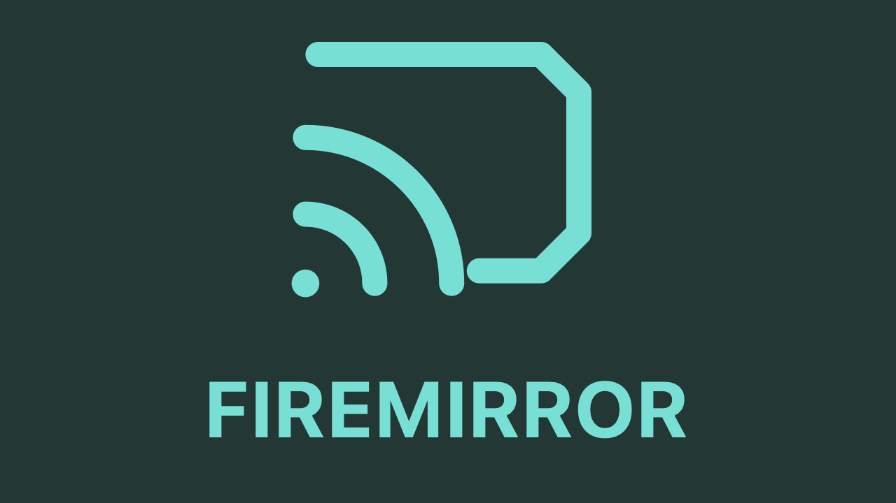
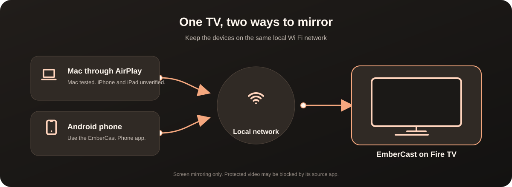

# EmberCast

<div align="center">
  
  <p><strong>Mirror a Mac or Android phone to your Fire TV over your local network.</strong></p>
</div>

<p align="center">
  <a href="https://github.com/mmorrone90/embercast/actions/workflows/android.yml"></a>
  <a href="LICENSE"></a>
</p>

EmberCast is a Fire TV screen mirroring receiver. Macs connect through AirPlay. Android phones use the separate EmberCast Phone app. Both connect over the same home network, with no cloud account or server.



## What it can do

* Receive Mac screen mirroring through AirPlay. The Mac path has been tested on a Fire TV Stick 3rd Gen.
* Receive Android phone screen video through EmberCast Phone. Supported app audio can also play through the TV on Android 10 and newer.
* Ask for approval on the TV when a new phone address tries to connect.
* Fit, crop, stretch, or zoom the picture, view connection health, show AirPlay photos, save screenshots, and record silent local clips.

The receiver is an Android APK for Android based Fire OS. It does not target Amazon Vega OS. iPhone and iPad mirroring is implemented through AirPlay but has not been verified on an Apple phone or tablet. Audio and performance depend on the sender, network, codec, and TV hardware.

Protected video surfaces can appear black while app controls or subtitles remain visible. EmberCast does not bypass DRM. Use the streaming service's Fire TV app for protected video. The Android phone video transport is not encrypted, so use it only on a trusted local network. Google Cast is not implemented; Fire TV's built in Miracast feature is separate.

## Install and try it

There is no signed public release yet. The project builds debug APKs for testing. You can build them on a Mac or download the temporary APK artifacts from a successful [Android build](https://github.com/mmorrone90/embercast/actions/workflows/android.yml) run. See [step by step installation](docs/INSTALL.md) for manual and AI assisted setup, Fire TV and Android phone installation, and troubleshooting.

To build from source, install JDK 17 and Android SDK tools, then run:

```sh
git clone --recurse-submodules https://github.com/mmorrone90/embercast.git
cd embercast
./scripts/build-receiver.sh
./scripts/build-phone.sh
```

The receiver APK is written to `dist/EmberCast-receiver-debug.apk`. The Android sender APK is written to `dist/EmberCast-phone-debug.apk`. To install the receiver over ADB, first enable ADB debugging on the TV and accept its authorization prompt:

```sh
./scripts/install.sh FIRE_TV_IP
```

Replace `FIRE_TV_IP` with the address shown in Fire TV network settings. Open EmberCast on the TV. On a Mac, choose **Control Centre → Screen Mirroring → EmberCast**. On Android, install and open EmberCast Phone, select the TV, and follow the screen capture and TV approval prompts.

## Compatibility and test status

The receiver requires Android API 24 or newer. EmberCast Phone requires Android API 26 or newer; its optional playback audio capture requires Android 10 or newer and an app that permits capture. The recorded hardware test used a Fire TV Stick 3rd Gen running Fire OS 7, Android API 28. See [validation notes](docs/VALIDATION.md) for what was tested and what remains unverified.

## Build and contribute

The root `app/` folder is an earlier TV interface prototype. The functional AirPlay receiver is built from the pinned `receiver/` source and `patches/receiver-embercast.patch`. Android application IDs retain their older `dev.firemirror.*` names so existing installations can receive compatible updates. Build and test procedures are in [CONTRIBUTING.md](CONTRIBUTING.md) and [development procedures](docs/PROCEDURES.md). GitHub Actions builds both APKs and runs the project checks for each change.

## License

The application code and receiver changes are GPL 3.0 only because the receiver is based on GPL licensed upstream code. The MIT license applies only to the project documentation and original artwork listed in [NOTICE.md](NOTICE.md). Tabler device icons are separately MIT licensed. See [all license and attribution details](NOTICE.md).

EmberCast is an independent project and is not affiliated with Apple or Amazon. AirPlay, Mac, macOS, and Fire TV are names of their respective owners.
